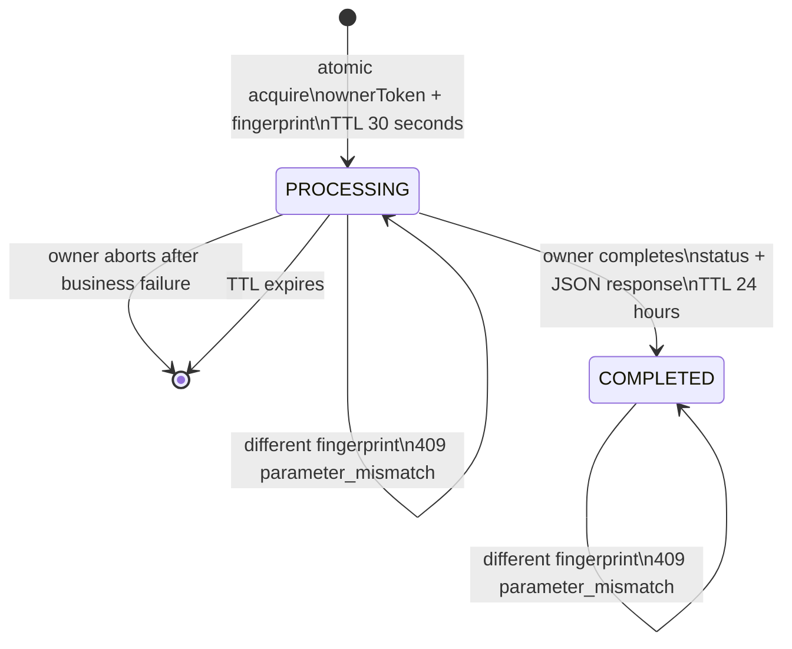

# Idempotency MVP

[](https://github.com/SeeWhy-star/idempotency-mvp/actions/workflows/ci.yml)

A small, standalone Java project that demonstrates four complementary layers of idempotency control in a payment-like workflow. It is designed for learning, code review, and interview discussion. It uses only public dependencies and generic names; it does not depend on proprietary code or infrastructure.

## Goals

The project demonstrates how idempotency is built from several safeguards rather than a single annotation or distributed lock:

| Layer | Mechanism | Problem addressed |
| --- | --- | --- |
| HTTP entry | `Idempotency-Key`, request fingerprint, atomic Redis state, response cache | Client retries, concurrent duplicate requests, and key reuse with different parameters |
| Concurrency | Redisson `RLock` scoped by payment intent ID | Concurrent callback handling across application instances |
| Business | Database state machine and conditional update | Duplicate or invalid state transitions even if a lock expires or is bypassed |
| Channel | Stable business idempotency key passed to `FakeChannelClient` | Safe downstream retries without generating a new random key each time |

This project demonstrates idempotency, not exactly-once delivery. Idempotency makes repeated execution produce an equivalent result without duplicating side effects. Exactly-once behavior across a database, cache, process, message broker, and external provider requires a broader protocol such as an outbox/inbox, transactional messaging, durable deduplication, reconciliation, and downstream cooperation.

## Technology

- Java 8
- Spring Boot 2.7.18
- Maven
- Spring AOP
- Spring Data Redis
- Redisson
- H2
- JUnit 5 and Mockito
- Redis 7.2 through Docker Compose

The application listens on port `18080`. Redis is expected at `localhost:6380`. Every Redis key created by the application starts with `idempotency:mvp:`.

## Architecture

```text
Client
  │ Idempotency-Key + request body
  ▼
@Idempotent AOP ── Redis Lua state machine ── cached response replay
  │ owner only
  ▼
PaymentIntentService ── H2 unique(account_id, merchant_order_no)
  │ stable paymentIntentId
  ▼
FakeChannelClient (no network access)

Payment callback
  │ paymentIntentId
  ▼
Redisson RLock ── re-read state inside lock ── conditional database UPDATE
```

Only methods explicitly annotated with `@Idempotent` are intercepted. The Redis request scope contains:

```text
accountId + HTTP method + normalized URI + Idempotency-Key
```

The scope is stored as a SHA-256 digest so the original account ID and client key are not exposed in the Redis key.

## HTTP idempotency protocol

### Create a payment intent

```http
POST /v1/payment_intents
X-Account-Id: account-001
Idempotency-Key: create-order-1001
Content-Type: application/json
```

```json
{
  "merchantOrderNo": "order-1001",
  "amount": 19.99,
  "currency": "USD"
}
```

The Redis hash stores at least:

- `status`: `PROCESSING` or `COMPLETED`
- `fingerprint`
- `ownerToken`
- `httpStatus`
- `responseBody`
- `createdAt`

The request body is serialized canonically and hashed with SHA-256. Reusing the same idempotency key with different parameters returns HTTP 409 rather than replaying an unrelated result.

### State transitions



`acquire`, `complete`, and `abort` are implemented as Redis Lua scripts. Only the request whose `ownerToken` created the `PROCESSING` record may complete or delete it.

### Why acquisition must be atomic

A `GET` followed by a separate `SET` has a race: two instances can both observe that the key is missing and both enter the business operation. The acquire Lua script checks the current state and writes `PROCESSING` as one indivisible Redis operation, so only one request receives execution ownership.

A duplicate request that finds `PROCESSING` returns immediately with HTTP 409. There is no sleep loop or polling retry.

### Why the fingerprint matters

An idempotency key identifies one logical request, but it does not prove that two request bodies are equivalent. The fingerprint prevents an old response from being replayed when a client accidentally reuses a key for a different amount, currency, or merchant order.

A completed response is cached as JSON text. On replay, the text is validated as JSON and returned with `application/json`, preserving the first response without a nested JSON string or a second serialization layer.

### Error examples

Request still processing:

```json
{
  "type": "idempotency_error",
  "code": "request_processing",
  "message": "A request with the same idempotency key is processing."
}
```

Key reused with different parameters:

```json
{
  "type": "idempotency_error",
  "code": "parameter_mismatch",
  "message": "The idempotency key has already been used with different parameters."
}
```

## Callback concurrency and database state

```http
POST /v1/callbacks/payments/{paymentIntentId}
Content-Type: application/json
```

```json
{
  "channelTransactionId": "channel-001",
  "status": "SUCCEEDED"
}
```

`SUCCEEDED` and `FAILED` are supported terminal callback states.

The Redisson lock key is:

```text
idempotency:mvp:payment_intent_processing_{paymentIntentId}
```

Lock acquisition is intentionally non-blocking:

```java
lock.tryLock(0, 20, TimeUnit.SECONDS)
```

If acquisition fails, the callback business operation is never executed. The `finally` block unlocks only when both `locked` and `lock.isHeldByCurrentThread()` are true. If lock acquisition is interrupted, the thread interrupt flag is restored.

### Why the state is re-read inside the lock

Another instance may commit a state change while this request is waiting to acquire the lock. Using an entity loaded before lock acquisition would make the decision from stale state. The callback therefore acquires the lock first and then queries the database again.

### Why the conditional update is the last line of defense

The state transition uses a single conditional statement:

```sql
UPDATE payment_intent
SET status = ?,
    channel_transaction_id = ?,
    updated_at = CURRENT_TIMESTAMP
WHERE id = ?
  AND status IN ('PROCESSING', 'REQUIRES_ACTION');
```

- `affectedRows == 1`: this request performed the transition.
- `affectedRows == 0`: the callback is a duplicate or the transition is no longer valid; no side effect is repeated.

Duplicate callbacks still receive an acceptable HTTP 200 response with `accepted=true` and `transitioned=false`, preventing unnecessary provider retries.

A distributed lock is an optimization and coordination mechanism, not the final correctness boundary. A lease can expire, Redis can become unavailable, or code can bypass the lock. The conditional update and the unique constraint on `(account_id, merchant_order_no)` provide durable database protection.

## Stable downstream idempotency key

`FakeChannelClient` performs no network request. It records its invocation count and every idempotency key it receives.

The payment intent is stored before channel submission, and its stable `paymentIntentId` is used as the downstream idempotency key. Retrying the same payment therefore reuses the same value instead of generating a new UUID or Snowflake ID for each attempt.

## Failure windows and limitations

### Redis failure

- If Redis fails before acquire, the business operation is not entered and the API returns an idempotency infrastructure error.
- If the business operation throws, the owner attempts an atomic abort. A non-owner cannot remove the record.
- Business exceptions are not stored as permanent completed responses.

### Business success followed by cache failure

There is an unavoidable crash window in this MVP: the database or fake channel operation may succeed, followed by failure while writing `COMPLETED` to Redis. The client may receive an error and retry after the `PROCESSING` record expires.

The database unique constraint, lookup of an existing payment intent, and stable downstream key reduce duplicate effects, but they do not create an atomic transaction across H2, Redis, and an external provider. A production design would normally add an outbox, durable event processing, reconciliation, and provider-side deduplication.

### Scope boundaries

- Single Redis instance and local H2 storage; no high-availability deployment.
- Cached responses include status and JSON body, but not every response header.
- The fingerprint covers the annotated method's request body. A production API should explicitly define which path, query, and header fields also affect the fingerprint.
- No real payment network, webhook signature verification, timeout policy, or reconciliation.
- No outbox, message broker, cross-region consistency, or observability dashboard.
- H2 does not perfectly reproduce the locking and isolation behavior of a production database.
- A fixed 20-second Redisson lease is not a business timeout guarantee. Long operations may require renewal, fencing tokens, or database serialization.

## Run locally

### Requirements

- Java 8 or newer, with source and target compatibility set to Java 8
- Docker with Compose for Redis
- `curl` for the demonstration script

The included Maven wrapper bootstraps Maven 3.9.9 from Maven Central and verifies its SHA-256 checksum.

### Start

```bash
docker compose up -d
./mvnw spring-boot:run
```

The API is available at `http://localhost:18080`. H2 data is stored under `./data/`.

### Stop Redis

```bash
docker compose down
```

## Tests

The default test suite does not require Docker. It uses a thread-safe in-memory idempotency store, in-memory H2, and mocked Redisson interfaces.

```bash
./mvnw checkstyle:check
./mvnw test
```

The suite covers:

1. First request executes and succeeds.
2. Same key and parameters replay the first result; business runs once.
3. Same key with different parameters returns HTTP 409.
4. Two truly concurrent requests allow only one into the business operation.
5. A duplicate finds `PROCESSING` and receives an explicit conflict.
6. A business exception safely clears the owner's `PROCESSING` record.
7. A non-owner cannot complete or abort another owner's record.
8. An expired `PROCESSING` record can be acquired again.
9. Duplicate callbacks perform one database transition.
10. Redisson lock acquisition failure never executes business logic.
11. Entry replay does not call `FakeChannelClient` twice.
12. Channel retries reuse the same stable business key.

The concurrency test uses `CountDownLatch` and `ExecutorService`; it is not a sequential simulation.

An optional integration test executes the real Lua scripts against Redis on port 6380:

```bash
docker compose up -d
RUN_REDIS_TESTS=true ./mvnw -Dtest=RedisIdempotencyStoreIntegrationTest test
```

GitHub Actions runs the complete suite, including the Redis integration test, against a Redis 7.2 service container.

## Curl examples

### Normal request and replay

```bash
curl -i -X POST http://localhost:18080/v1/payment_intents \
  -H 'Content-Type: application/json' \
  -H 'X-Account-Id: acct-001' \
  -H 'Idempotency-Key: create-order-1001' \
  -d '{"merchantOrderNo":"order-1001","amount":19.99,"currency":"USD"}'

# Run the same command again. It returns HTTP 201 and the first JSON response
# without executing the business operation again.
```

### Parameter mismatch

```bash
curl -i -X POST http://localhost:18080/v1/payment_intents \
  -H 'Content-Type: application/json' \
  -H 'X-Account-Id: acct-001' \
  -H 'Idempotency-Key: create-order-1001' \
  -d '{"merchantOrderNo":"order-1001","amount":29.99,"currency":"USD"}'

# HTTP 409, code=parameter_mismatch
```

### Duplicate callback

```bash
curl -i -X POST \
  http://localhost:18080/v1/callbacks/payments/{paymentIntentId} \
  -H 'Content-Type: application/json' \
  -d '{"channelTransactionId":"channel-001","status":"SUCCEEDED"}'

# Run it again. It returns HTTP 200, accepted=true, transitioned=false.
```

The complete demonstration is also available as:

```bash
./scripts/demo.sh
```

## Project layout

```text
src/main/java/com/example/idempotencymvp/
├── annotation/   # @Idempotent
├── aop/          # HTTP entry interceptor
├── idempotency/  # protocol service, Redis Lua store, in-memory store
├── lock/         # Redisson and local lock executors
├── controller/   # HTTP endpoints and DTOs
├── service/      # creation, channel submission, callback transition
├── repository/   # JPA repository and conditional UPDATE
├── domain/       # PaymentIntent and its state
├── channel/      # FakeChannelClient
├── exception/    # structured API errors
└── config/       # Redisson configuration
```

## Interview summary

> This project demonstrates four complementary layers of idempotency. At the HTTP entry, a custom `@Idempotent` aspect scopes the request by account, method, normalized URI, and `Idempotency-Key`, then calculates a request fingerprint. Redis Lua atomically acquires a `PROCESSING` record: a concurrent duplicate immediately gets a 409, a completed duplicate receives the original status and JSON, and a key reused with different parameters is rejected. Payment callbacks use a non-blocking Redisson lock scoped by payment intent ID and re-read database state after acquiring it. The actual transition is a conditional SQL update, so only a pending state can move to a terminal state; a duplicate callback returns success without repeating side effects. Finally, downstream retries use the stable payment intent ID instead of a fresh random key. Redis and distributed locks are not treated as absolute correctness guarantees, so the database unique constraint and conditional update remain the durable fallback. The README also calls out the crash window between business success and Redis completion, so the project demonstrates idempotency without claiming exactly-once delivery.

## License

Released under the [MIT License](LICENSE).
